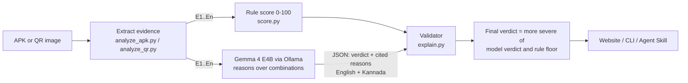

# ScamShield

**Check before you trust.** ScamShield is an offline scam checker for two of the most
common traps in India: fake Android app files sent on WhatsApp, and fake or tampered
UPI QR codes. It reads the file without ever running it, scores what it finds with
open rules, and uses **Gemma 4 E4B**, an open-weight model running locally through
Ollama, to explain the risk in plain **English and Kannada**.

Built for MLH Hacktoberfest Hack Day, Track 1: Best Open-Source AI Project.

## The problem

In 2025, people in India reported losing about ₹19,813 crore to cyber fraud across
more than 21 lakh complaints, and Karnataka lost ₹2,413 crore, the second highest of
any state ([I4C data via IANS](https://ianslive.in/indians-lose-over-rs-52976-crore-to-cyber-frauds-over-six-years-report--20260103154943)).
Two scams need no skill from the scammer:

1. **Fake APKs**: "RTO challan", "KYC update" or "PM Kisan" apps sent on WhatsApp.
   Once installed, they read SMS, steal OTPs and can even tap buttons on the screen.
2. **Fake UPI QR codes**: a scammer's QR pasted over a shop's, or a "scan to receive
   ₹5,000" code. Scanning a QR can never *receive* money. It only sends it.

Victims can't inspect an app's permissions or read a UPI link, and most tools explain
risk in English technical terms, if at all.

## What it does

- **APK check**: permissions, Telegram-bot and IP exfiltration links, impersonation of
  government/bank names, debug or missing signatures, known code packers.
- **Windows program check**: catches `.exe` files disguised as documents (`receipt.pdf.exe`,
  or a program renamed to `.pdf` / `.apk`), keylogger functions, Telegram/IP links,
  code packers and missing publisher signatures.
- **Message check**: paste an SMS or WhatsApp message (and optionally the sender). Catches
  look-alike bank/government links, short links, `.apk` download links, requests for OTP/PIN,
  KYC and electricity-disconnection threats, part-time job and "digital arrest" scams, and
  organisations writing from personal numbers. Genuine OTP and bank messages stay Safe.
- **QR check**: decodes the UPI link (including Bharat QR merchant codes) from a photo or screenshot and flags pre-filled amounts, "receive money"
  wording, personal-number payees, and names that don't match the shop.
- **Verdict**: Safe, Suspicious or Dangerous, with reasons that cite numbered evidence,
  fixed safety steps (1930 helpline, cybercrime.gov.in) and a full decision trail.
- **Website** with an English/Kannada toggle, demo samples, light and dark mode.
- **Agent Skill** (`skills/scamshield/`) following the
  [Agent Skills spec](https://agentskills.io/specification), usable from OpenCode.

## How the AI is used



The rules find individual signals. **Gemma's job is the part rules can't do well**:
work out what a combination of signals means for a non-technical person ("it reads your
SMS *and* sends data to a Telegram bot, so it steals OTPs") and say it simply in Kannada.

Three guardrails keep the model honest:

1. It only sees extracted evidence and must cite evidence IDs for every reason.
2. The validator drops any reason citing an ID that does not exist.
3. The final verdict is the **more severe** of the model's verdict and the rule floor,
   so the model can raise the risk level but never talk it down.

If Ollama isn't running, or the model returns invalid JSON twice, ScamShield falls back
to rule-based template explanations, so the demo never crashes. Safety steps (what to do
next) are always fixed text and never come from the model.

## Model and license

- **Model**: Gemma 4 E4B (`gemma4:e4b` in Ollama), a small open-weight model
  (about 4.5B effective parameters, under the 10B "small language model" line).
- **Model card and terms**: [google/gemma-4-E4B-it on Hugging Face](https://huggingface.co/google/gemma-4-E4B-it)
  and [Gemma documentation](https://ai.google.dev/gemma/docs/core). Google released
  Gemma 4 under Apache 2.0; check the model card for the current terms before reuse.
- The model weights are **not** included in this repository.
- **This project's code**: Apache-2.0, see [LICENSE](LICENSE) and [NOTICE](NOTICE).

## Run it

### 1. Install Ollama and the model

Follow the [Ollama quickstart](https://docs.ollama.com/quickstart), then:

```bash
ollama pull gemma4:e4b      # about 10 GB download
# Laptops with less than 16 GB RAM:
ollama pull gemma4:e2b && export SCAMSHIELD_MODEL=gemma4:e2b
```

### 2. Install and start ScamShield

```bash
git clone <your-repo-url> scamshield && cd scamshield
python -m venv .venv && source .venv/bin/activate   # Windows: .venv\Scripts\activate
pip install -r requirements.txt
uvicorn app.server:app --port 8000
```

Open **http://localhost:8000**. The pill at the top right shows whether Gemma is ready.
Click any demo sample to see a full check.

Settings (environment variables):

| Variable | Default | Purpose |
|---|---|---|
| `SCAMSHIELD_MODEL` | `gemma4:e4b` | Ollama model tag |
| `OLLAMA_HOST` | `http://localhost:11434` | Ollama address |
| `SCAMSHIELD_NO_MODEL` | unset | Set to `1` to use rule explanations only |
| `SCAMSHIELD_TIMEOUT` | `120` | Seconds to wait for the model |
| `SCAMSHIELD_REPO_URL` | unset | Shows a GitHub link in the footer |

### 3. Command line

```bash
cd skills/scamshield
python scripts/check.py --apk ../../samples/out/fake_rto_challan.apk --lang en
python scripts/check.py --qr ../../samples/out/qr_sticker.png --shop "Sharma General Store" --lang kn
```

### 4. Use it as an Agent Skill in OpenCode

Copy or symlink `skills/scamshield` into a skills folder OpenCode reads (see the
[OpenCode skills docs](https://opencode.ai/docs/skills)), then run OpenCode on Gemma:

```bash
ollama launch opencode --model gemma4
```

Ask: *"Is this APK safe? samples/out/fake_rto_challan.apk"*. The agent loads
`SKILL.md` and runs `scripts/check.py`.

## Demo samples

`samples/make_demo_samples.py` builds harmless samples into `samples/out/`:

| Sample | Expected |
|---|---|
| `fake_rto_challan.apk` (SMS + accessibility + Telegram bot URL, debug certificate) | Dangerous |
| `simple_calculator.apk` | Safe |
| `fake_sbi_kyc_update.apk` (SMS theft, fake login overlay, bare IP) | Dangerous |
| `fake_pm_kisan.apk` (packed code, installs more apps) | Dangerous |
| `quickcash_loan.apk` (contacts, call log, SMS) | Suspicious |
| `Traffic_Challan_Receipt.pdf.exe` (program posing as a PDF, keylogger + Telegram bot) | Dangerous |
| `PM_Kisan_Update.apk` (actually a packed Windows program) | Dangerous |
| `PhotoViewer_Setup.exe` (signed installer) | Safe |
| Electricity disconnection SMS from a personal number | Dangerous |
| SBI KYC SMS with a look-alike link | Dangerous |
| Part-time job WhatsApp with a Telegram link | Dangerous |
| "Cyber Crime Branch" digital-arrest message | Dangerous |
| Genuine HDFC Bank OTP message | Safe |
| `qr_shop.png` (matches the shop) | Safe |
| `qr_cashback.png` ("scan to receive ₹5,000") | Dangerous |
| `qr_sticker.png` (another shop's QR stuck on top) | Suspicious |

The demo Windows programs have headers and strings but no code, and Windows refuses to
start them. The APKs are generated byte by byte: a binary manifest, a DEX file holding only a
string table (no classes or methods, nothing executable) and a v1 signature. See
[samples/README.md](samples/README.md).

## Tests

```bash
pytest
```

Covers every demo verdict, rule combinations, QR parsing, the API, and the validator:
invented evidence IDs are dropped, the model can't lower a verdict, and invalid or
missing model output falls back to rules. `tests/fake_ollama.py` is a stand-in Ollama
server for testing the model path without Gemma.

## Key dependencies

| Package | Used for |
|---|---|
| [Ollama](https://ollama.com) + Gemma 4 E4B | Local model runtime and explanations |
| androguard | Parsing APK manifest, certificate and DEX strings |
| zxing-cpp | Robust QR decoding from real phone photos (angles, glare, dense codes) |
| opencv-python-headless | Image loading and a backup QR decoder |
| rapidfuzz | Shop name matching |
| FastAPI, uvicorn, python-multipart | Web server |
| requests | Local calls to Ollama |
| qrcode, cryptography | Building the demo samples |
| pytest, httpx | Tests |
| Anek Latin / Anek Kannada (OFL) | Bundled fonts, so the site works offline |

## Limitations

- **Packed or obfuscated apps** can hide code from static analysis. Known packers are
  flagged, but this is a first line of defence, not an antivirus.
- **No real UPI name lookup.** The registered name behind a UPI ID is only available to
  banks and licensed providers (NPCI members). `verify_upi.py` uses mock data and is a
  plug-in point for a licensed verification API. Users should always read the name their
  payment app shows before entering a PIN.
- **Mock merchant data** in `assets/demo_merchants.json` is invented.
- **Kannada quality** from a small model varies; fixed templates cover every rule, and a
  native speaker should review them before wider use.
- **Not a replacement for antivirus** or for official channels.

## Safety

ScamShield never installs, runs or emulates an APK. The only network call is to the local
Ollama server. Uploaded files are written to a temporary folder and deleted after the
check. Results are guidance, not a guarantee.

If you have lost money: call **1930** or report at **cybercrime.gov.in**.

## Project layout

```
app/                     FastAPI server and website (static HTML/CSS/JS, bundled fonts)
skills/scamshield/       Agent Skill: SKILL.md, scripts/, references/RULES.md, assets/
samples/                 Demo sample builder and generated samples
tests/                   pytest suite and a fake Ollama server
tools/                   check_licenses.py (dependency license audit)
```

## Team

Add your team members here.

## License

ScamShield is licensed under **Apache-2.0**. See [LICENSE](LICENSE) and [NOTICE](NOTICE).

Every third-party component, with its license, is listed in
[THIRD_PARTY_LICENSES.md](THIRD_PARTY_LICENSES.md): Gemma 4 (Apache-2.0), Ollama (MIT),
the Agent Skills spec, OpenCode, the bundled Anek fonts (OFL-1.1) and all 66 Python
packages. No GPL or AGPL code is used. Re-check with `python tools/check_licenses.py`.
